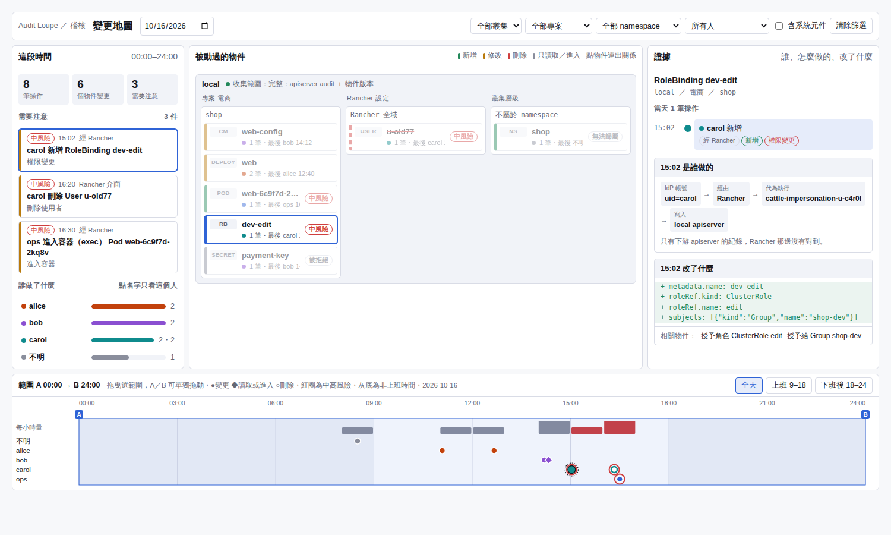

# Audit Loupe

在 Rancher 裡回答「誰、在什麼時候、透過什麼管道、對哪個物件、改了什麼」。
Answers *who changed what, when, and how* across Rancher-managed Kubernetes clusters, inside the Rancher UI.

**狀態：M1、M2 的程式完成，尚未在真實叢集跑過。** 後端 72 個測試通過；收集元件以假的 Kubernetes／SUSE Security API 跑過完整流程；介面以示意資料在獨立頁面驗證過，還沒載入 Rancher。實機驗證見 [`docs/lab/m1-m2-lab-task.md`](docs/lab/m1-m2-lab-task.md)。
**Status: M1 and M2 code complete, not yet run on a real cluster.** 72 backend tests pass; collectors were run end to end against fake Kubernetes and SUSE Security APIs; the UI was checked with demo data in a standalone page, not yet inside Rancher.

- 設計：[`docs/design.md`](docs/design.md)
- 部署：[`docs/deploy.md`](docs/deploy.md)
- 介面模型（示意資料，瀏覽器直接開）：[`mock/change-map.html`](mock/change-map.html)

## 做得到的事 / What it does

- **變更地圖**：被動過的物件依叢集、專案、namespace 分組；點物件看關係線、每一步操作、身分鏈（IdP 帳號 → Rancher 介面或 kubectl → 代為執行的帳號 → apiserver）與改前改後。Rancher 與下游兩份紀錄自動對成一筆。
- **需要注意**：刪 namespace、權限變更、進入容器、繞過 Rancher、繞過 GitOps、變更窗口外的變更、刪除使用者等，同一人短時間內的連續動作合成一件。
- **權限覆核**：任一時間點每個人有哪些 Rancher 權限、誰在什麼時候給的、兩個日期之間多了誰少了誰，匯出 CSV。
- **使用者刪除之後**：名冊保留，刪除後重新加入的帳號合併顯示並可分開看。
- **防竄改與 SIEM**：紀錄串成雜湊鏈，錨點與整理過的紀錄轉送 syslog、Splunk HEC 或 webhook。
- **還原用 YAML**：產生改之前的內容，只產生、不套用。
- **收集狀態**：每個收集元件的回報、中斷時段、找不到 audit log 的叢集。
- **SUSE Security**：exec 之後被判定為違規的程序（不是完整指令紀錄）。
- **規則可調**：每條規則可以開關、調整嚴重度、設定不適用的範圍（附理由，可設到期日）。設定變更後，可以選擇用新設定重新計算過去的紀錄，原始紀錄不變。

## 第一版的做法 / M1 approach

| 環境 | 是誰 | 改了什麼 |
|---|---|---|
| Rancher 本身（local cluster） | Rancher API audit log | 物件版本監看 |
| Rancher 建立的 RKE2 下游叢集 | 下游 kube-apiserver audit log | 物件版本監看 |

- 收集元件把紀錄推送到後端，每座叢集一把 token；後端位置預設 local cluster，可以改放其他叢集。
- 後端在寫入時把畫面要用的資料整理好，查詢只讀資料庫，不重讀原始 log。
- 介面是 Rancher 的全域頁面，經 Rancher service proxy 存取後端，看資料的權限由 Rancher RBAC 決定。
- 每座叢集都標出收集涵蓋度，看不到的部分會明講。

- Collectors push to the backend with a per-cluster token; the backend runs in the local cluster by default and can be moved.
- Data is shaped at write time; the UI queries the database, never the raw logs.
- The UI is a Rancher global page that reaches the backend through the Rancher service proxy, so Rancher RBAC controls who can see audit data.
- Every cluster shows what it does and does not collect.

## 組成 / Layout

| 路徑 | 內容 |
|---|---|
| `backend/` | Rust（axum、kube-rs、SQLite）。`cargo test`；`audit-loupe seed-demo` 產生示意資料 |
| `deploy/chart/` | Helm chart（server 與各收集元件，values 決定角色） |
| `deploy/policy/` | RKE2 apiserver audit policy |
| `scripts/` | 在本機建置映像檔（離線環境或自建 registry） |
| `.github/workflows/` | CI：PR 檢查（`ci.yml`）、版本 tag 發佈多架構映像檔（`release-images.yml`） |
| `docs/lab/` | 實機驗證任務書 |
| `mock/` | 介面設計模型 |
| `docs/archive/m0/` | 試吃版的 webhook 做法與 lab 任務書，僅供參考 |

UI extension 在另一個 repo：[yansheng133/audit-loupe-ui](https://github.com/yansheng133/audit-loupe-ui)，用 Rancher 官方的 extension workflow 發佈。

## 發佈 / Release

- 每個 PR 與 main 的每次 push 都會跑後端測試與 Helm chart 檢查（`ci.yml`），沒過不能合併。
- 推一個版本 tag（例如 `v0.3.0`）會在 amd64 與 arm64 的機器上各自建置映像檔，合成多架構的 `audit-loupe-server`、`audit-loupe-collector` 推到 Docker Hub（`release-images.yml`）。tag、`backend/Cargo.toml`、`deploy/chart/Chart.yaml` 的版本必須一致，否則不會發佈。

## 授權 / License

Apache-2.0
