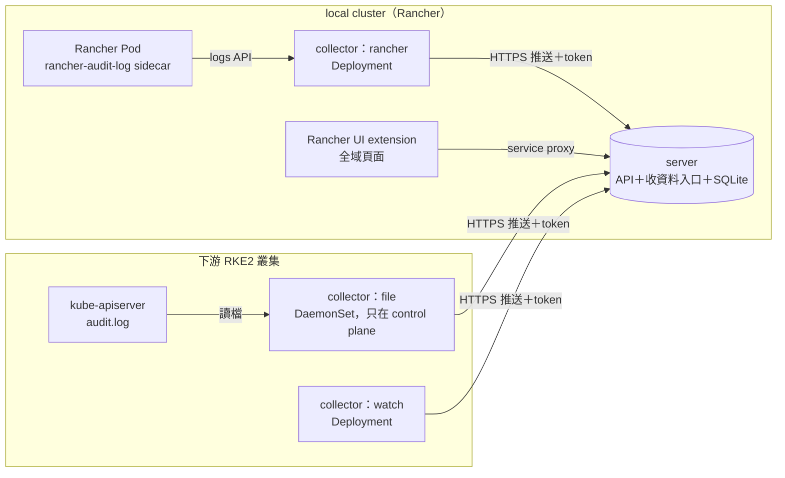

# Audit Loupe 設計文件

Audit Loupe 把 Rancher 與 Kubernetes 的稽核紀錄整理成看得懂的畫面：誰、在什麼時候、透過什麼管道、對哪個物件做了什麼，以及改前改後的差異。

這份文件記錄第一版（M1）已定案的設計。標註「待 lab 驗證」的項目，是官方文件沒有寫、從原始碼推論出來的行為，必須在實際環境確認後才能寫進對外文件。

## 1. 範圍

第一版只支援兩種環境：

| 環境 | 「是誰」從哪來 | 「改了什麼」從哪來 |
|---|---|---|
| Rancher 本身（local cluster） | Rancher API audit log | 物件版本監看 |
| Rancher 建立的 RKE2 下游叢集 | 下游 kube-apiserver audit log | 物件版本監看 |

匯入的叢集、雲端代管叢集（EKS／AKS／GKE）列為之後的版本。

不在範圍內：攔截或阻擋操作（Audit Loupe 只記錄、不攔截）、取代 SIEM、長期歸檔。

## 2. 架構



所有元件都是同一個 Rust 程式，以子命令區分角色：

| 子命令 | 跑在哪裡 | 做什麼 |
|---|---|---|
| `server` | 預設 local cluster，可改放其他叢集 | 收資料、整理、寫入 SQLite、提供查詢 API |
| `collect-rancher` | local cluster | 透過 Kubernetes logs API 讀 `rancher-audit-log` 容器的輸出 |
| `collect-file` | 下游叢集的 control plane 節點 | 讀 `/var/lib/rancher/rke2/server/logs/audit.log` |
| `collect-watch` | 每座要看「改了什麼」的叢集 | 監看物件，變更時送出新版本 |
| `seed-demo` | 任何地方 | 產生示意資料，給沒有叢集時試用介面 |

### 2.1 後端位置

後端（`server`）預設放在 local cluster，也可以放在其他叢集。後端在哪座叢集，就在那座開收資料的入口；收集元件只需要知道入口網址和 token，所以後端搬家時只要改這兩個值。

介面透過 local cluster 上的一份設定（記錄後端所在的叢集 ID、namespace 與 Service 名稱）找到後端，再經該叢集的 Rancher service proxy 查詢：

```
/k8s/clusters/<叢集 ID>/api/v1/namespaces/audit-loupe-system/services/http:audit-loupe:8080/proxy/api/...
```

這條路走的是登入者自己的 Rancher 權限，所以「誰能看稽核資料」直接由 Rancher RBAC 決定：要有後端所在 namespace 的 `services/proxy` 權限。

### 2.2 收集與推送

收集元件採推送。理由：後端位置之後可能放到 local 以外的叢集，推送不必依賴 Rancher 的通道。

- **入口**：後端以 Ingress 或 LoadBalancer 開 HTTPS 入口，TLS 憑證由 cert-manager 簽發或使用者自備。
- **每座叢集一把 token**：後端依 token 判斷資料來自哪座叢集，不採信收集元件自己報的叢集名稱。停用或更換某座叢集的 token，不影響其他叢集。之後可加 mTLS。
- **批次送出**：收集元件攢成一批、壓縮後送出，收到後端確認才把「讀到的位置」往前記。後端暫時無法連線時，資料留在原本的 log 檔，恢復後補送。
- **`collect-rancher` 的讀法**：每 15 秒列出 `cattle-system` 裡 `app=rancher` 的 Pod，每個 Pod 一條連線跟讀 `rancher-audit-log` 容器的輸出（帶 kubelet 時間戳）。每個 Pod 以 UID 記「後端已確認到哪個時間」，連線中斷或收集元件重啟後，從那個時間前一秒接著讀（`sinceTime` 只到秒），重疊的部分由後端以 `auditID` 排除。Pod 被刪除時，還沒讀到的部分會跟著消失，畫面標為收集中斷。
- **只收 Rancher 叢集送來的 Rancher 紀錄**：Rancher 紀錄可以指名任何下游叢集（URI 裡的叢集 ID），所以只接受 Rancher 所在叢集（預設 `local`）那把 token 送來的 Rancher 紀錄。
- **排除重複**：Rancher 紀錄以 `auditID` 判斷，下游 apiserver 紀錄以 `auditID` 判斷，物件版本以 UID 加 resourceVersion 判斷；收過的不重複寫入。
- **網路需求**：每座下游叢集要能連到後端的入口，部署說明會列出這條防火牆規則。

### 2.3 寫入時整理，查詢時只讀資料庫

收集只讀一次，後端在寫入時把畫面需要的東西都算好，查詢時只走索引，不碰原始 log：

- 解析出操作者、管道、動詞、物件。
- 把 Rancher 紀錄與下游 apiserver 紀錄對成同一筆（見第 4 節）。
- 判斷風險等級，把同一張憑證短時間內的連續動作合成一件事。
- 存物件版本與物件之間的關係（owner、掛載、NetworkPolicy 選到誰、Ingress 導到哪個 Service／工作負載）。
- 每小時操作量在寫入時累加。

資料預設保留 30 天，可以調整。儲存層包成一層介面，量大時可以換成 PostgreSQL，不影響其他部分。

## 3. 各來源的開啟方式（已查證）

### 3.1 Rancher API audit log

- 以 Rancher chart 的 Helm 值開啟：`auditLog.enabled`（預設 `false`）、`auditLog.level`（0～3，預設 0）、`auditLog.destination`（預設 `sidecar`，另一選項 `hostPath`）。
- level 0 只記 metadata，1 加 header，2 加 request body，3 加 response body，逐級累加。Audit Loupe 建議 level 1。
- sidecar 模式會在 Rancher Pod 裡多一個 `rancher-audit-log` 容器，把 `/var/log/auditlog/rancher-api-audit.log` 印到 stdout。`collect-rancher` 讀這個容器的輸出，不需要 hostPath，也不需要特權。
- 每筆是一行 JSON。`user.name` 是 Rancher 使用者 ID（`u-xxxxx`），`user.extra.username`、`user.extra.principalid` 是外部 IdP 的帳號，level 0 就有。
- 內建遮蔽 Authorization、Cookie 等 header，以及 Secret、ConfigMap 的內容。2.12 起可用 `AuditPolicy`（`auditlog.cattle.io/v1`）加過濾與遮蔽規則，不必重啟 Rancher。
- 改 `auditLog.*` Helm 值會改到 Pod template，Rancher Pod 會滾動重建（從 chart 推論，待 lab 驗證）。
- 經 `/k8s/clusters/...` 轉送到下游的請求也會記錄（原始碼確認，文件未明寫）。
- **例外**：exec、attach、port-forward、介面上的 shell 這類升級成長連線的請求不會記錄（原始碼確認，待 lab 驗證）。這類操作只能由下游 apiserver audit log 取得。
- 以下幾點從 Rancher 原始碼（`pkg/auth/audit`）確認，寫解析程式時要配合：
  - 紀錄沒有動詞與物件欄位，要從 HTTP method 與 `requestURI` 推出來。URI 有四種：經 Rancher 轉送的 Kubernetes API（`/k8s/clusters/<叢集 ID>/api|apis/...`）、Steve（`/v1/<型別>/...`，Rancher 介面用的 API）、Norman（`/v3/<型別>/<ID>?action=...`，使用者、權限綁定、token 這類管理物件）、登入（`/v3-public/...?action=login`）。
  - 時間只到秒（`time.RFC3339`），而且是 Rancher Pod 的時區。對應下游紀錄時要把這一秒的誤差算進去（見第 4 節）。
  - request body 只在 PUT、POST 且 level 2 以上才記；PATCH 的內容不會出現在 Rancher 紀錄裡，改了什麼要靠下游紀錄或物件版本。
  - 較新的原始碼多了 `user.identity`（username、provider、principalId）與 `user.impersonatedBy`，由 `audit-log-username` 功能開關控制。Rancher 在寫入當下用使用者 ID 查名字填進去，使用者已刪除就查不到。Audit Loupe 有這個欄位就用，沒有就退回 `user.extra`。哪個 Rancher 版本開始有、預設是否開啟，待查證。
  - 本機登入的紀錄有 `userLoginName`（登入表單上打的帳號），登入失敗時 `user.name` 是 `system:unauthenticated`，要靠這個欄位才知道是誰在試。

### 3.2 RKE2 apiserver audit log

- 一般安裝**不會**寫 audit log。只有設定 `profile: cis` 或 `audit-policy-file` 時，才會寫到 `/var/lib/rancher/rke2/server/logs/audit.log`，此時預設輪替值為保留 30 天、10 個檔、每檔 100 MB。
- RKE2 自動產生的預設 policy 是 `level: None`，等於什麼都不記，所以一定要提供自己的 policy。
- 改 policy 後必須重啟 rke2-server，kube-apiserver 會重建（文件明寫）。
- Rancher 建立的叢集：在叢集設定的 `machineGlobalConfig` 設 `audit-policy-file`，值放 policy 內容本身，Rancher 會把檔案送到節點。改設定後 Rancher 會依 upgrade strategy 逐台重啟（從原始碼推論，待 lab 驗證）。
- **不要**改用 `kube-apiserver-arg` 傳 policy 路徑：那樣 RKE2 不會套用預設的 log 路徑與輪替設定。
- kube-apiserver 是 static pod，mirror pod 的參數從 API 讀得到，可以用來在不登入節點的情況下判斷 audit 有沒有開（從原始碼推論，待 lab 驗證）。

建議的 policy 放在 `deploy/policy/rke2-audit-policy.yaml`（見第 5 節）。

## 4. 把兩份紀錄對成同一筆

經 Rancher 操作下游叢集時，同一個動作會出現兩次：

1. Rancher 紀錄：`requestURI` 以 `/k8s/clusters/<叢集 ID>/` 開頭，`user.name` 是 `u-xxxxx`。
2. 下游 apiserver 紀錄：`user.username` 是 `system:serviceaccount:cattle-impersonation-system:cattle-impersonation-u-xxxxx`，`impersonatedUser` 帶著真正的使用者，`extra.username`、`extra.principalid` 是 IdP 帳號。

對應條件：同一座叢集、同一個 Rancher 使用者 ID、同一個物件與動詞，時間相差 2 秒內。Rancher 紀錄只到秒，而且記的是回應時間（晚於下游完成時間），實作上接受 Rancher 時間減下游時間在 -2 秒到 +3 秒之間，取最接近的一筆，一對一配對。哪一邊先到都可以，寫入時就配好。對到的合成一列（畫面與統計只算下游那一筆，Rancher 那一筆提供用戶端位址與 User-Agent，用來分辨介面或 kubectl），畫面上的身分鏈顯示：IdP 帳號 → Rancher（介面或 kubectl）→ 代為執行的帳號 → 下游 apiserver。

只有下游紀錄、沒有 Rancher 紀錄的操作（例如用節點上的管理者憑證），標為「繞過 Rancher」。只有 Rancher 紀錄、對不到下游紀錄的操作（下游沒開 audit），涵蓋度標為「經 Rancher 的操作」。

### 4.1 使用者被刪除之後

身分不能靠查詢時再去 Rancher 找名字，人一刪就查不到。做法：

1. **寫入時保存身分**：每筆事件存下 `u-xxxxx`、IdP 帳號、principal，以及當時名冊上的顯示名稱。之後使用者被刪，舊紀錄照樣看得出是誰。
2. **使用者名冊**：`collect-watch` 監看 local cluster 的 `users.management.cattle.io`，記錄每個 `u-xxxxx` 的顯示名稱、principal、建立時間、刪除時間。使用者被刪時名冊只標記「已刪除」，不移除；只要還有事件指向他就保留。畫面上照樣顯示名字，旁邊加「已刪除」標籤，可點到刪除那筆操作。
3. **刪除後的連帶清除**：Rancher 刪除使用者後自動清掉的權限綁定（CRTB、PRTB 等），標為「刪除使用者後由 Rancher 自動清除」，不算成高風險操作。
4. **對不起來就照實標示**：Audit Loupe 安裝前就被刪的人、或紀錄沒帶 IdP 欄位的路徑，顯示「無法辨識的使用者 `u-xxxxx`」，不猜。

**同一個人被刪後又重新加入**：

- Rancher 為外部 IdP 使用者產生 ID 的方式是 `u-` 加上 principal 的 SHA-256 前 10 碼（`pkg/auth/providers/common/usermanager.go`）。所以同一個 IdP 帳號被刪除後再登入，會拿回**同一個** `u-xxxxx`，只是 User 物件的 UID 不同。
- 因此合併的依據是 `u-xxxxx` 本身，一個 `u-xxxxx` 可能有好幾段「生命期」，以 User 物件的 UID 區分。名冊記錄每一段的 UID、建立時間、刪除時間。
- Rancher 本機帳號的 ID 是隨機產生的，刪除後重建會是不同的 `u-xxxxx`，一律不合併：同名不代表同一個人。
- 介面上一定要看得出來：曾被刪除又重新加入的人，名字旁加「曾刪除後重新加入（N 段）」標籤，展開可看到每一段的建立與刪除時間、各自的操作筆數。
- 可以分開來看，分開後每一段各自一列。M1 只做檢視切換：每位使用者在自己的畫面上展開或分開，不影響別人、不需要寫入權限。
- 事件屬於哪一段，以事件時間對到名冊裡那一段的建立、刪除時間來判斷，查詢時決定，所以分開或合併都不需要改寫資料。
- 同一個人換了 IdP（例如從 LDAP 換到 OIDC）會變成不同 principal、不同 `u-xxxxx`，這種情況不自動合併。

## 5. 流量控管

叢集多時量會很大。三層控管，第一層效果最大：

1. **來源端少記**
   - RKE2 policy：只記寫入動詞（create、update、patch、delete、deletecollection），以及 Secret 讀取、pods/exec、pods/attach、pods/portforward；lease、event、endpoints、系統帳號的例行請求一律 `None`。
   - Rancher：以 `AuditPolicy` 過濾掉介面輪詢的 GET。
2. **收集端批次送出**：見 2.2。
3. **後端批次寫入**：單一寫入程序，一批一個交易。

lab 實測時要量：每座叢集每秒幾筆、過濾前後差多少、每天佔多少空間，作為推算多叢集規模的依據。

## 6. 涵蓋度標示

每座叢集在畫面上標出收到什麼程度的紀錄，避免讓人以為有紀錄、其實沒有：

| 標示 | 條件 |
|---|---|
| 完整 | 有 apiserver audit，也有物件版本 |
| 經 Rancher 的操作 | 只有 Rancher audit log；看不到繞過 Rancher 的操作，也看不到進入容器 |
| 只知道改了什麼 | 只有物件版本 |
| 收集中斷 | 收集元件超過設定時間沒有回報 |

安裝前的探測（判斷叢集類型、讀 apiserver mirror pod 的參數）會給出建議的收集方式。

## 7. 介面

做成 Rancher 的全域頁面（`inStore: 'management'`），從每座叢集的 Dashboard 放一張卡片連過去並帶入叢集篩選。官方沒有「在其他產品側欄加連結」的擴充點，所以用卡片。

版面以 `mock/change-map.html` 為準：

- 上方一列篩選：叢集、專案、namespace、人物視角、是否包含系統元件。
- 中間三欄各自捲動：左邊是這段時間的摘要與「需要注意」，中間是分組拓撲（叢集 → 專案 → namespace → 物件），右邊是證據（操作時間線、身分鏈、改前改後、相關物件）。
- 下方固定時間軸：每小時操作量加上每人一列，拖曳選範圍。
- 拓撲只畫被動過的物件；點物件時才畫出它的關係線。
- 一開啟就選好最嚴重的一件。

套件必須帶 `catalog.cattle.io/ui-extensions-version: ">= 3.0.0 < 4.0.0"`，否則 Rancher 不會載入。整頁不捲動、各欄自己捲動的版面，官方沒有說明，待 lab 驗證。

## 8. 待 lab 驗證的項目

1. 改 Rancher `auditLog.*` 時 Pod 是否滾動重建、中斷多久。
2. exec、port-forward、介面 shell 是否真的不進 Rancher audit log。
3. 改 `machineGlobalConfig` 的 `audit-policy-file` 時，節點實際的重啟順序與時間。
4. 從 apiserver mirror pod 讀得到 audit 參數。
5. logs API 長時間讀取的穩定性，以及 Rancher Pod 重建後能否接續。
6. 四種情境在畫面上是否正確：經 Rancher 介面、經 Rancher kubectl、用節點管理者憑證繞過 Rancher、收集元件中斷。
7. 過濾前後的紀錄量與儲存空間。
8. UI extension 整頁版面。
9. Rancher 本身內建 Fleet 的版本有沒有 `fleet.cattle.io/managed-by-*` 標籤；local cluster 上 Fleet agent 的 namespace（`cattle-fleet-local-system` 或其他）；Fleet 自動改回時 audit log 裡的動詞。
10. SUSE Security 在 Monitor 模式下，對 exec 進去執行的指令會不會產生違規事件（zero-drift 對 exec 有例外）。
11. Steve URI 的實際形式：型別名稱是複數（`apps.deployments`）還是單數；兩段路徑（`/v1/<型別>/<x>`）在新增、修改、刪除時的意義。
12. `user.identity` 欄位從哪個 Rancher 版本開始有、`audit-log-username` 預設是否開啟。
13. 經 ACE（Authorized Cluster Endpoint）直連下游時，下游紀錄是否帶 IdP 欄位；刪除使用者後 Rancher 自動清除了哪些物件；被刪除的 `u-xxxxx` 是否可能被重新使用。

## 9. 分階段

| PR | 內容 |
|---|---|
| 1 | 從試吃版（M0）搬入並改名；本文件 |
| 2 | 收資料入口改為每座叢集一把 token，批次格式，`collect-file` |
| 3 | `collect-rancher`、Rancher 紀錄解析、兩份紀錄對應 |
| 4 | `collect-watch` 改為推送；物件關係；使用者名冊與帳號合併；寫入時整理（事件合併、每小時統計） |
| 5 | UI extension 改為全域頁面與新版面 |
| 6 | Helm chart（server、各 collector）、RKE2 policy、部署說明 |
| 7 | lab 實測與報告 |

### 9.1 M2：從「看得到」到「拿得出來給稽核看」

M1 完成、lab 驗證過後再做。順序依「稽核最常問、資料已經有」排：

| PR | 內容 | 要點 |
|---|---|---|
| 8 | 權限覆核 | 見 9.2 |
| 9 | 防竄改與轉送 SIEM | 見 9.3 |
| 10 | 繞過 GitOps | 見 9.4 |
| 11 | 變更窗口 | 取代「非上班時間」規則：依叢集、namespace 標籤設定核准的時段，窗口外的正式環境寫入標中風險。之後可再加 ITSM 變更單號欄位比對（各家系統不同，先不做） |
| 12 | 產生還原用的 YAML | 從已存的版本產出「改之前」的 YAML，只產生、不套用；Audit Loupe 不需要、也不會有寫入叢集的權限。Secret 不在版本範圍內，所以不會產出含機密的內容 |
| 13 | 涵蓋度健康頁 | 每座叢集：audit 有沒有開、收集元件最後回報時間、延遲、缺口時段。收集元件每分鐘送一次心跳（空批次也送），後端以心跳判斷缺口 |
| 14 | SUSE Security 違規事件 | 見 9.5 |
| 15 | 規則可調、重新計算 | 見 9.6 |

### 9.2 權限覆核（已查證，Rancher 原始碼 main，2026-10-16）

要回答：「某人現在有哪些權限、是誰在什麼時候給的」，以及「兩個日期之間，多了誰、少了誰」。

- **要存版本的物件**（local cluster，`management.cattle.io`）：GlobalRole、GlobalRoleBinding、RoleTemplate、ClusterRoleTemplateBinding、ProjectRoleTemplateBinding、Project、User、UserAttribute。
- **有效權限要自己算**：Rancher 沒有任何物件或狀態存放算好的有效權限。由 binding 找到 RoleTemplate，沿 `roleTemplateNames` 遞迴展開、合併 rules；`external: true` 的改讀同名 ClusterRole。因為每個版本都存了，所以可以算出任一時間點的狀態。
- **內建角色會在 Rancher 升級時改變**：`builtin: true` 的角色在 Rancher 啟動時重新同步，沒有操作者。這類變更標為「Rancher 升級帶來的權限變化」，不歸給任何人。
- **衍生的 binding**：GlobalRole 帶 `inheritedClusterRoles` 時，Rancher 會自動產生帶 `authz.management.cattle.io/grb-owner` 標籤的 CRTB。這類標為衍生，歸到原本那筆 GlobalRoleBinding。
- **誰給的**：binding 物件上沒有建立者（webhook 只對 Cluster、Project 加 `creatorId`）。建立者只能從 audit log 對出來，這正是 Audit Loupe 獨有的價值。自動產生的 binding（`creator-*`、新使用者預設的 `grb-*`）標為 Rancher 自動建立。
- **binding 的 subject 會補值**：只寫 `userPrincipalName` 的 binding，之後控制器會補上 `userName`（反之亦然）。比對時以 `userName` 為準，第一版沒有時往後找。
- **經群組取得的權限只能盡力而為**：使用者屬於哪些群組只記在 UserAttribute，而且只是「上次更新時」的狀態。更新時機：登入時、使用 API 時超過 `auth-user-info-max-age-seconds`（預設 3600 秒）、每天排程（`auth-user-info-resync-cron`，預設 `0 0 * * *`）。SAML（Shibboleth 除外）與 generic OIDC 只在登入時更新。所以畫面上經群組取得的權限一律標「依 Rancher 最後一次更新的群組資料，可能落後最多一天」，SAML、generic OIDC 標「只在登入時更新」。
- **UserAttribute 雜訊**：`LastRefresh`、`LastLogin` 每次更新都會變，存版本前要先去掉，只在群組真的改變時才存新版本。
- **輸出**：畫面一頁加 CSV 匯出，欄位：人、權限、範圍（全域／叢集／專案）、取得方式（直接或經群組）、授權者、授權時間。季度比對輸出新增、移除兩張表。

### 9.3 防竄改與轉送 SIEM

- **雜湊鏈**：每座叢集一條鏈，寫入時每筆事件存 `hash = SHA-256(前一筆 hash + 本筆正規化內容)`。畫面與 API 可以驗證某段時間的鏈是否完整。
- **錨點**：鏈只放在同一個資料庫裡，改資料的人也可以重算整條鏈。所以每小時把最新的 hash 送到資料庫以外的地方（SIEM、或寫入有 Object Lock 的 S3 相容儲存空間），之後拿外部的錨點比對才有意義。文件要寫清楚：沒有設定外部錨點時，雜湊鏈只能偵測意外損毀，不能證明沒被刻意竄改。
- **轉送 SIEM**：送的是整理過的事件（身分鏈、叢集、物件、風險），不是原始 log。三種出口：syslog over TLS（RFC 5424，內容 JSON）、Splunk HEC、通用 webhook。送出失敗時排隊重送，畫面顯示積壓量。
- **定位**：Audit Loupe 幫 SIEM 補上 Kubernetes 的上下文，不取代 SIEM。長期保存交給客戶既有的 SIEM 或儲存，Audit Loupe 本身維持 30 天。

### 9.4 繞過 GitOps（已查證，Fleet 原始碼 main，2026-10-16）

- **判斷物件由 Fleet 管理**：看物件本身的 `objectset.rio.cattle.io/id` annotation，或較新 Fleet 加的 `fleet.cattle.io/managed-by-kind`、`managed-by-namespace`、`managed-by-name` 標籤（後者還能指出是哪個 GitRepo）。只有 Helm 的標籤（`app.kubernetes.io/managed-by=Helm`）不算，任何 Helm release 都有。
- **Fleet 自己的寫入**：Fleet agent 以 `system:serviceaccount:cattle-fleet-system:fleet-agent` 寫入；有設定時會再代為執行某個 service account（audit log 裡 `user` 是 fleet-agent、`impersonatedUser` 是那個 SA）。local cluster 的 namespace 可能不同，從 Fleet Cluster 物件的 `status.agent.namespace` 讀。
- **規則**：人對 Fleet 管理的物件寫入，標「繞過 GitOps」（中風險），畫面顯示是哪個 GitRepo 管的。
- **之後的結果**：Fleet 的 `correctDrift` 預設關閉，只偵測、不改回。若之後在同一物件看到 fleet-agent 的寫入，標「已被 Fleet 改回」；沒有就標「仍與 Git 不一致」，並可對照 BundleDeployment 的 `status.modifiedStatus`。

### 9.5 SUSE Security 違規事件（已查證，NeuVector 原始碼與文件 5.6，2026-10-14）

原本想回答「exec 進去之後跑了什麼」，查證後範圍要縮小：

- SUSE Security 不會記錄每個程序。Discover 模式只學習、不產生事件；Monitor、Protect 模式只在程序不在允許清單時產生違規事件。另有內建可疑程序偵測（nmap、nc、ssh、反向 shell 等），任何模式都會報。所以**拿不到完整的指令紀錄**，只拿得到被判定為違規或可疑的程序。
- 有一支記錄最近 400 個程序的 API（`/v1/workload/:id/process_history`），但文件沒有記載、資料只在記憶體、容器結束就消失，不採用。
- **做法**：以唯讀 API key（只給「Security Event」讀取權限，可限定 namespace）定期讀 `/v1/log/security`，用 namespace、Pod、時間窗對到 exec 事件。父程序是 runc、containerd-shim 的視為經 exec 啟動。控制器只保留各類最近 4096 筆，要常讀或改用 syslog 推送。
- **畫面用語**：一律寫「SUSE Security 判定為違規的程序」，不寫「執行過的指令」，避免讓人以為是完整紀錄。

### 9.6 規則可調與重新計算

規則判斷「哪些操作值得再看一眼」。每條規則固定一種情境，客戶可以調整的是：開或關、嚴重度、不適用的範圍。規則本身不能自訂，偵測新情境要改程式。

- **設定**：Helm values 的 `server.rules`，轉成環境變數 `AL_RULES`（JSON）。沒寫到的規則維持預設。設定有誤時，例如規則或欄位名稱打錯、例外沒寫理由、例外沒寫範圍，後端拒絕啟動並指出位置，不會默默把規則關掉。介面只能看設定，不能改。
- **例外**：可指定叢集、namespace、namespace label、使用者、資源。同一個例外裡寫了的欄位都要符合，`*` 是萬用字元；使用者會比對名稱、Rancher user ID、IdP principal。理由必填；到期日選填，比對的是操作發生的時間，所以重新計算的結果不會因為「哪天重算」而不同。
- **何時判斷**：紀錄寫入時就判斷，並存下當時的嚴重度。需要物件資料的規則（繞過 GitOps 要看 Fleet 標記；變更窗口與 namespace label 例外要看 namespace 的 label）都取「操作當時」的版本，所以重新計算跟寫入時的判斷一致。
- **設定變更紀錄**：後端啟動時，把規則、變更窗口、時區、上班時間算成一個設定代碼（SHA-256 前 16 碼）。代碼跟上次不同就記一筆，並記下從哪一筆紀錄開始使用。之後就能回答「某筆紀錄是用哪一版設定判斷的」。
- **重新計算**：設定變了之後，舊紀錄維持原本的判斷，介面會出現提示，說明有多少筆、預估時間，以及兩個限制：只算保留期限內的紀錄、已轉送 SIEM 的警示不會重送。使用者按下才開始，可以選「先不要」，只在這個瀏覽器隱藏，下次設定變更時會再出現。
  - 在背景執行，每 2,000 筆釋放一次資料庫鎖，期間收集與查詢照常進行。
  - 先算進另一組表（警示、事件串、每小時統計），最後連同期間新進的紀錄一起在一個交易內換上，畫面不會出現一半新一半舊的狀態。
  - 原始紀錄與雜湊鏈不受影響：鏈只涵蓋原始欄位，不含警示。
  - 預估時間：依上次實測速度，沒有實測過就用每秒 10,000 筆估算。測試環境實測約每秒 70,000 筆，所以第一次的預估會偏長。
  - 執行中重啟：該次記為「因重啟中斷」，中途的表丟棄，原本的判斷不變。
  - 事件串依紀錄的時間順序重建。即時寫入時是依抵達順序合併，收集元件批次送出、紀錄晚到時，兩者的分組可能略有不同（例如 02:00、02:15、02:07 依序抵達，即時是兩件，重新計算後是一件）；以時間順序為準。
  - 計算期間才對上的 Rancher 紀錄與下游紀錄，換上前會照即時寫入的方式扣回，不會重複計算。
  - 保留期限以前的紀錄（因為還被物件版本引用而留下）只重算警示，不再產生每小時統計與事件串。
  - 事件串的編號接續原本的編號，已送到 SIEM 的編號不會被另一件重複使用。
- **升級前的紀錄**：第一次啟動這個版本時，既有紀錄視為用目前設定判斷過（之前的版本沒有可調的規則）。如果同一次升級也改了設定，「規則」頁可以手動「重新計算全部紀錄」。
- **誰能啟動**：經 Rancher service proxy 的 POST 需要 `services/proxy` 的 `create` 權限，只有讀取權限的稽核人員按了會被拒絕。後端拿不到是誰按的，只記錄時間；誰改了設定，看 Helm release 或 Deployment 的 audit 紀錄。
- **目前不做**：在介面上改規則（要另外處理「誰能改」以及改規則本身的稽核）；ServiceAccount 的規則（要先改 audit policy 記錄 SA 的讀取，量會變大，另案規劃）。

## 10. 依據

- Rancher：Enabling the API Audit Log — https://ranchermanager.docs.rancher.com/how-to-guides/advanced-user-guides/enable-api-audit-log
- Rancher：Helm chart options — https://ranchermanager.docs.rancher.com/getting-started/installation-and-upgrade/installation-references/helm-chart-options
- Rancher：User ID tracking in audit logs — https://ranchermanager.docs.rancher.com/troubleshooting/other-troubleshooting-tips/user-id-tracking-in-audit-logs
- rancher/rancher 原始碼（v2.15）：`pkg/auth/audit/`、`chart/templates/deployment.yaml`
- RKE2：Hardening guide — https://docs.rke2.io/security/hardening_guide
- RKE2：Server config reference — https://docs.rke2.io/reference/server_config
- Rancher：RKE2 cluster configuration — https://ranchermanager.docs.rancher.com/reference-guides/cluster-configuration/rancher-server-configuration/rke2-cluster-configuration
- Rancher UI extensions：Products、Cards、Publishing — https://extensions.rancher.io/extensions/next/api/nav/products
