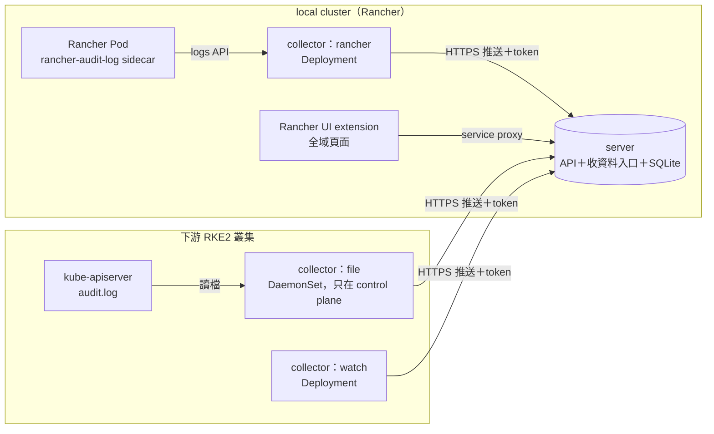

# Audit Loupe 設計文件

Audit Loupe 把 Rancher 與 Kubernetes 的稽核紀錄整理成看得懂的畫面：誰、在什麼時候、透過什麼管道、對哪個物件做了什麼，以及改前改後的差異。

這份文件記錄第一版（M1）已定案的設計。標註「待 lab 驗證」的項目，是官方文件沒有寫、從原始碼推論出來的行為，必須在實際環境確認後才能寫進對外文件。

## 1. 範圍

第一版只支援兩種環境：

| 環境 | 「是誰」從哪來 | 「改了什麼」從哪來 |
|---|---|---|
| Rancher 本身（local cluster） | Rancher API audit log | 物件版本監看 |
| Rancher 建立的 RKE2 下游叢集 | 下游 kube-apiserver audit log | 物件版本監看 |

匯入的叢集、雲端代管叢集（EKS／AKS／GKE）列為之後的版本。

不在範圍內：攔截或阻擋操作（Audit Loupe 只記錄、不攔截）、取代 SIEM、長期歸檔。

## 2. 架構



所有元件都是同一個 Rust 程式，以子命令區分角色：

| 子命令 | 跑在哪裡 | 做什麼 |
|---|---|---|
| `server` | 預設 local cluster，可改放其他叢集 | 收資料、整理、寫入 SQLite、提供查詢 API |
| `collect-rancher` | local cluster | 透過 Kubernetes logs API 讀 `rancher-audit-log` 容器的輸出 |
| `collect-file` | 下游叢集的 control plane 節點 | 讀 `/var/lib/rancher/rke2/server/logs/audit.log` |
| `collect-watch` | 每座要看「改了什麼」的叢集 | 監看物件，變更時送出新版本 |
| `seed-demo` | 任何地方 | 產生示意資料，給沒有叢集時試用介面 |

### 2.1 後端位置

後端（`server`）預設放在 local cluster，也可以放在其他叢集。後端在哪座叢集，就在那座開收資料的入口；收集元件只需要知道入口網址和 token，所以後端搬家時只要改這兩個值。

介面透過 local cluster 上的一份設定（記錄後端所在的叢集 ID、namespace 與 Service 名稱）找到後端，再經該叢集的 Rancher service proxy 查詢：

```
/k8s/clusters/<叢集 ID>/api/v1/namespaces/audit-loupe-system/services/http:audit-loupe:8080/proxy/api/...
```

這條路走的是登入者自己的 Rancher 權限，所以「誰能看稽核資料」直接由 Rancher RBAC 決定：要有後端所在 namespace 的 `services/proxy` 權限。

### 2.2 收集與推送

收集元件採推送。理由：後端位置之後可能放到 local 以外的叢集，推送不必依賴 Rancher 的通道。

- **入口**：後端以 Ingress 或 LoadBalancer 開 HTTPS 入口，TLS 憑證由 cert-manager 簽發或使用者自備。
- **每座叢集一把 token**：後端依 token 判斷資料來自哪座叢集，不採信收集元件自己報的叢集名稱。停用或更換某座叢集的 token，不影響其他叢集。之後可加 mTLS。
- **批次送出**：收集元件攢成一批、壓縮後送出，收到後端確認才把「讀到的位置」往前記。後端暫時無法連線時，資料留在原本的 log 檔，恢復後補送。
- **排除重複**：Rancher 紀錄以 `auditID` 判斷，下游 apiserver 紀錄以 `auditID` 判斷，物件版本以 UID 加 resourceVersion 判斷；收過的不重複寫入。
- **網路需求**：每座下游叢集要能連到後端的入口，部署說明會列出這條防火牆規則。

### 2.3 寫入時整理，查詢時只讀資料庫

收集只讀一次，後端在寫入時把畫面需要的東西都算好，查詢時只走索引，不碰原始 log：

- 解析出操作者、管道、動詞、物件。
- 把 Rancher 紀錄與下游 apiserver 紀錄對成同一筆（見第 4 節）。
- 判斷風險等級，把同一張憑證短時間內的連續動作合成一件事。
- 存物件版本與物件之間的關係（owner、掛載、NetworkPolicy 選到誰、Ingress 導到哪個 Service／工作負載）。
- 每小時操作量在寫入時累加。

資料預設保留 30 天，可以調整。儲存層包成一層介面，量大時可以換成 PostgreSQL，不影響其他部分。

## 3. 各來源的開啟方式（已查證）

### 3.1 Rancher API audit log

- 以 Rancher chart 的 Helm 值開啟：`auditLog.enabled`（預設 `false`）、`auditLog.level`（0～3，預設 0）、`auditLog.destination`（預設 `sidecar`，另一選項 `hostPath`）。
- level 0 只記 metadata，1 加 header，2 加 request body，3 加 response body，逐級累加。Audit Loupe 建議 level 1。
- sidecar 模式會在 Rancher Pod 裡多一個 `rancher-audit-log` 容器，把 `/var/log/auditlog/rancher-api-audit.log` 印到 stdout。`collect-rancher` 讀這個容器的輸出，不需要 hostPath，也不需要特權。
- 每筆是一行 JSON。`user.name` 是 Rancher 使用者 ID（`u-xxxxx`），`user.extra.username`、`user.extra.principalid` 是外部 IdP 的帳號，level 0 就有。
- 內建遮蔽 Authorization、Cookie 等 header，以及 Secret、ConfigMap 的內容。2.12 起可用 `AuditPolicy`（`auditlog.cattle.io/v1`）加過濾與遮蔽規則，不必重啟 Rancher。
- 改 `auditLog.*` Helm 值會改到 Pod template，Rancher Pod 會滾動重建（從 chart 推論，待 lab 驗證）。
- 經 `/k8s/clusters/...` 轉送到下游的請求也會記錄（原始碼確認，文件未明寫）。
- **例外**：exec、attach、port-forward、介面上的 shell 這類升級成長連線的請求不會記錄（原始碼確認，待 lab 驗證）。這類操作只能由下游 apiserver audit log 取得。

### 3.2 RKE2 apiserver audit log

- 一般安裝**不會**寫 audit log。只有設定 `profile: cis` 或 `audit-policy-file` 時，才會寫到 `/var/lib/rancher/rke2/server/logs/audit.log`，此時預設輪替值為保留 30 天、10 個檔、每檔 100 MB。
- RKE2 自動產生的預設 policy 是 `level: None`，等於什麼都不記，所以一定要提供自己的 policy。
- 改 policy 後必須重啟 rke2-server，kube-apiserver 會重建（文件明寫）。
- Rancher 建立的叢集：在叢集設定的 `machineGlobalConfig` 設 `audit-policy-file`，值放 policy 內容本身，Rancher 會把檔案送到節點。改設定後 Rancher 會依 upgrade strategy 逐台重啟（從原始碼推論，待 lab 驗證）。
- **不要**改用 `kube-apiserver-arg` 傳 policy 路徑：那樣 RKE2 不會套用預設的 log 路徑與輪替設定。
- kube-apiserver 是 static pod，mirror pod 的參數從 API 讀得到，可以用來在不登入節點的情況下判斷 audit 有沒有開（從原始碼推論，待 lab 驗證）。

建議的 policy 放在 `deploy/policy/rke2-audit-policy.yaml`（見第 5 節）。

## 4. 把兩份紀錄對成同一筆

經 Rancher 操作下游叢集時，同一個動作會出現兩次：

1. Rancher 紀錄：`requestURI` 以 `/k8s/clusters/<叢集 ID>/` 開頭，`user.name` 是 `u-xxxxx`。
2. 下游 apiserver 紀錄：`user.username` 是 `system:serviceaccount:cattle-impersonation-system:cattle-impersonation-u-xxxxx`，`impersonatedUser` 帶著真正的使用者，`extra.username`、`extra.principalid` 是 IdP 帳號。

對應條件：同一座叢集、同一個 Rancher 使用者 ID、同一個物件與動詞，時間相差 2 秒內。對到的合成一列，畫面上的身分鏈顯示：IdP 帳號 → Rancher（介面或 kubectl）→ 代為執行的帳號 → 下游 apiserver。

只有下游紀錄、沒有 Rancher 紀錄的操作（例如用節點上的管理者憑證），標為「繞過 Rancher」。

### 4.1 使用者被刪除之後

身分不能靠查詢時再去 Rancher 找名字，人一刪就查不到。做法：

1. **寫入時保存身分**：每筆事件存下 `u-xxxxx`、IdP 帳號、principal，以及當時名冊上的顯示名稱。之後使用者被刪，舊紀錄照樣看得出是誰。
2. **使用者名冊**：`collect-watch` 監看 local cluster 的 `users.management.cattle.io`，記錄每個 `u-xxxxx` 的顯示名稱、principal、建立時間、刪除時間。使用者被刪時名冊只標記「已刪除」，不移除；只要還有事件指向他就保留。畫面上照樣顯示名字，旁邊加「已刪除」標籤，可點到刪除那筆操作。
3. **刪除後的連帶清除**：Rancher 刪除使用者後自動清掉的權限綁定（CRTB、PRTB 等），標為「刪除使用者後由 Rancher 自動清除」，不算成高風險操作。
4. **對不起來就照實標示**：Audit Loupe 安裝前就被刪的人、或紀錄沒帶 IdP 欄位的路徑，顯示「無法辨識的使用者 `u-xxxxx`」，不猜。

**同一個人被刪後又重新加入**（新的 `u-xxxxx`）：

- 以 IdP principal（AD、LDAP、Keycloak 等外部帳號）相同為條件，合併成同一個人。
- Rancher 本機帳號一律不合併：同名不代表同一個人。
- 介面上一定要看得出是合併的結果：人名旁加「已合併 N 個帳號」標籤，展開可看到每個 `u-xxxxx` 的建立與刪除時間、各自的操作筆數。
- 可以把合併的帳號分開來看，分開後每個 `u-xxxxx` 各自一列。M1 只做檢視切換：每位使用者在自己的畫面上展開或分開，不影響別人、不需要寫入權限。由管理者永久標記「這兩個帳號不是同一個人」需要寫入 API、權限控管，標記本身也要留稽核紀錄，等實際遇到誤合併再做。
- 合併只影響顯示與統計，資料庫裡每筆事件仍保留原本的 `u-xxxxx`，所以分開或合併都不需要改寫資料。

## 5. 流量控管

叢集多時量會很大。三層控管，第一層效果最大：

1. **來源端少記**
   - RKE2 policy：只記寫入動詞（create、update、patch、delete、deletecollection），以及 Secret 讀取、pods/exec、pods/attach、pods/portforward；lease、event、endpoints、系統帳號的例行請求一律 `None`。
   - Rancher：以 `AuditPolicy` 過濾掉介面輪詢的 GET。
2. **收集端批次送出**：見 2.2。
3. **後端批次寫入**：單一寫入程序，一批一個交易。

lab 實測時要量：每座叢集每秒幾筆、過濾前後差多少、每天佔多少空間，作為推算多叢集規模的依據。

## 6. 涵蓋度標示

每座叢集在畫面上標出收到什麼程度的紀錄，避免讓人以為有紀錄、其實沒有：

| 標示 | 條件 |
|---|---|
| 完整 | 有 apiserver audit，也有物件版本 |
| 經 Rancher 的操作 | 只有 Rancher audit log；看不到繞過 Rancher 的操作，也看不到進入容器 |
| 只知道改了什麼 | 只有物件版本 |
| 收集中斷 | 收集元件超過設定時間沒有回報 |

安裝前的探測（判斷叢集類型、讀 apiserver mirror pod 的參數）會給出建議的收集方式。

## 7. 介面

做成 Rancher 的全域頁面（`inStore: 'management'`），從每座叢集的 Dashboard 放一張卡片連過去並帶入叢集篩選。官方沒有「在其他產品側欄加連結」的擴充點，所以用卡片。

版面以 `mock/change-map.html` 為準：

- 上方一列篩選：叢集、專案、namespace、人物視角、是否包含系統元件。
- 中間三欄各自捲動：左邊是這段時間的摘要與「需要注意」，中間是分組拓撲（叢集 → 專案 → namespace → 物件），右邊是證據（操作時間線、身分鏈、改前改後、相關物件）。
- 下方固定時間軸：每小時操作量加上每人一列，拖曳選範圍。
- 拓撲只畫被動過的物件；點物件時才畫出它的關係線。
- 一開啟就選好最嚴重的一件。

套件必須帶 `catalog.cattle.io/ui-extensions-version: ">= 3.0.0 < 4.0.0"`，否則 Rancher 不會載入。整頁不捲動、各欄自己捲動的版面，官方沒有說明，待 lab 驗證。

## 8. 待 lab 驗證的項目

1. 改 Rancher `auditLog.*` 時 Pod 是否滾動重建、中斷多久。
2. exec、port-forward、介面 shell 是否真的不進 Rancher audit log。
3. 改 `machineGlobalConfig` 的 `audit-policy-file` 時，節點實際的重啟順序與時間。
4. 從 apiserver mirror pod 讀得到 audit 參數。
5. logs API 長時間讀取的穩定性，以及 Rancher Pod 重建後能否接續。
6. 四種情境在畫面上是否正確：經 Rancher 介面、經 Rancher kubectl、用節點管理者憑證繞過 Rancher、收集元件中斷。
7. 過濾前後的紀錄量與儲存空間。
8. UI extension 整頁版面。
9. 經 ACE（Authorized Cluster Endpoint）直連下游時，下游紀錄是否帶 IdP 欄位；刪除使用者後 Rancher 自動清除了哪些物件；被刪除的 `u-xxxxx` 是否可能被重新使用。

## 9. 分階段

| PR | 內容 |
|---|---|
| 1 | 從試吃版（M0）搬入並改名；本文件 |
| 2 | 收資料入口改為每座叢集一把 token，批次格式，`collect-file` |
| 3 | `collect-rancher`、Rancher 紀錄解析、兩份紀錄對應 |
| 4 | `collect-watch` 改為推送；物件關係；使用者名冊與帳號合併；寫入時整理（事件合併、每小時統計） |
| 5 | UI extension 改為全域頁面與新版面 |
| 6 | Helm chart（server、各 collector）、RKE2 policy、部署說明 |
| 7 | lab 實測與報告 |

## 10. 依據

- Rancher：Enabling the API Audit Log — https://ranchermanager.docs.rancher.com/how-to-guides/advanced-user-guides/enable-api-audit-log
- Rancher：Helm chart options — https://ranchermanager.docs.rancher.com/getting-started/installation-and-upgrade/installation-references/helm-chart-options
- Rancher：User ID tracking in audit logs — https://ranchermanager.docs.rancher.com/troubleshooting/other-troubleshooting-tips/user-id-tracking-in-audit-logs
- rancher/rancher 原始碼（v2.15）：`pkg/auth/audit/`、`chart/templates/deployment.yaml`
- RKE2：Hardening guide — https://docs.rke2.io/security/hardening_guide
- RKE2：Server config reference — https://docs.rke2.io/reference/server_config
- Rancher：RKE2 cluster configuration — https://ranchermanager.docs.rancher.com/reference-guides/cluster-configuration/rancher-server-configuration/rke2-cluster-configuration
- Rancher UI extensions：Products、Cards、Publishing — https://extensions.rancher.io/extensions/next/api/nav/products
