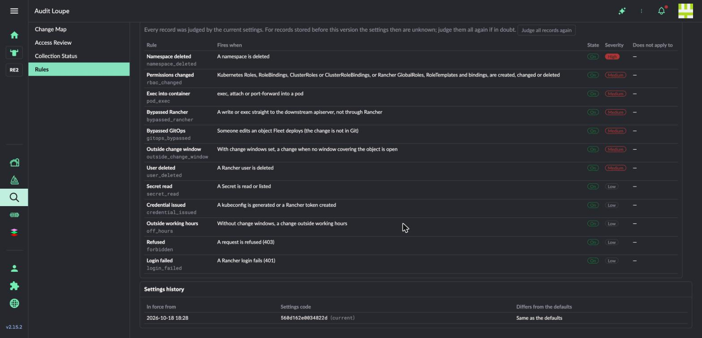
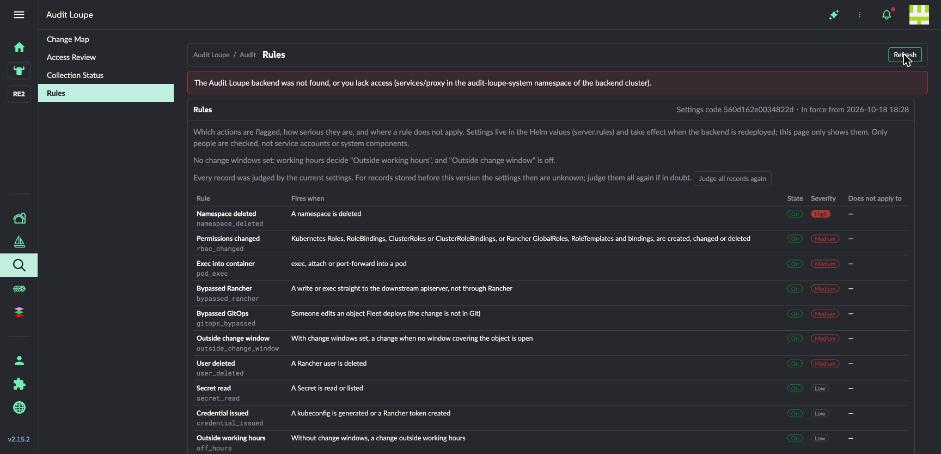
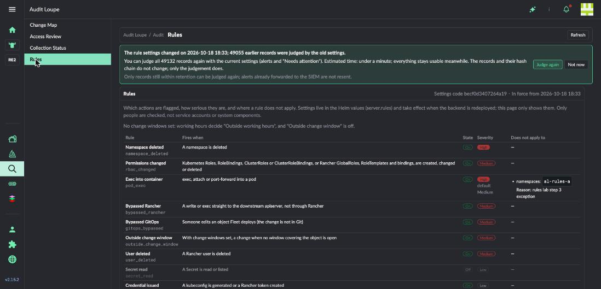
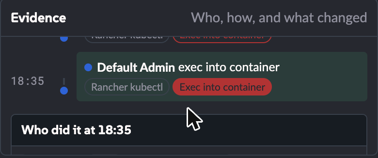
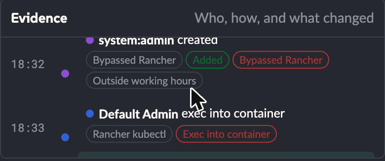
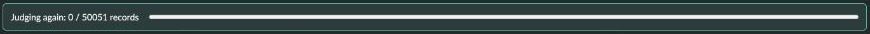

# Lab 回報：規則可調與重新計算（0.3.0）

實測日期：2026-10-18（台北時間 18:20–19:05）。對應任務書：`docs/lab/rules-lab-task.md`。

## 一句話結論

規則可以調、改了之後新紀錄馬上用新設定、舊紀錄按一下就能全部重新判斷，而且結果都對；但有兩件事跟任務書的預期不一樣：**設定寫錯時後端會停擺**（舊的不會繼續服務），以及**重新計算快到無法在實機測「計算到一半被重啟」**。

## 名詞

| 名詞 | 意思 |
|---|---|
| 規則 | 決定哪些動作要被標記、標記成多嚴重。例如「進入容器執行指令」預設是「中」 |
| 例外 | 某條規則在哪些地方不適用，例如某個 namespace。每個例外都必須寫原因 |
| 判斷 | 一筆紀錄被哪些規則標記、各是什麼嚴重度 |
| 重新計算 | 用目前的規則，把已經存著的紀錄全部重新判斷一次。紀錄本身和雜湊鏈不變 |
| 雜湊鏈 | 每筆紀錄都帶著前一筆的雜湊值，任何一筆被改過都看得出來 |
| exec | 進入容器裡執行指令（`kubectl exec`） |
| service proxy | Rancher 介面連到 Audit Loupe 後端的通道；權限用 Kubernetes 的 `services/proxy` 控制 |

## 環境

- Rancher 2.15.2，所在叢集與下游叢集都是 RKE2 v1.36.4，arm64，lab 環境。
- Audit Loupe 從 0.2.2 升級到 0.3.0（映像檔只有 arm64）。UI 用 Developer Load 從本機載入。
- 測試期間建了兩個 namespace：`al-rules-a`（拿來當例外）、`al-rules-b`（對照組），各放一個只會 `sleep` 的 Pod。

## 每一步的結果

| 步驟 | 結果 | 摘要 |
|---|---|---|
| 1 升級、不改設定 | 通過 | 規則頁 1 筆設定紀錄、沒有重新計算提示；升級前後舊資料的判斷逐筆相同 |
| 2 錯誤設定 | **部分不符** | 新 Pod 起不來、log 第一行正確；但**舊 Pod 沒有繼續服務**，後端停了約 1 分鐘 |
| 3 調整設定 | 通過 | 兩個頁面都出現提示，筆數等於當時全部紀錄，有預估時間 |
| 4 新紀錄用新設定 | 通過 | 例外 namespace 沒有警示、另一個是「高」，之前的 exec 仍是「中」 |
| 5 權限 | 通過（API）；畫面未實際操作 | 只有 get 的帳號送出重新計算被擋（403），伺服器沒有開始 |
| 6 重新計算 | 通過 | 50,051 筆 0.12 秒；結果全部符合預期；期間新紀錄照常進來；雜湊鏈完整 |
| 7 計算中重啟 | **實機未驗** | 計算太快，Pod 被刪之前就已經做完 |
| 8 SIEM | 未做 | lab 沒有設定任何轉送目的地 |

### 1. 升級到本版、不改設定

- 升級前後各從 API 取一次固定期間（10/17 00:00 到 10/18 17:00）的資料比對：警示 1,484 筆、事件串 15 個，**每一筆的判斷都一樣**。唯一的差別是 0.3.0 多了 `alert_severity` 欄位（每個警示的嚴重度）。
- 10/17 的變更地圖升級前後都是：338 個動作、98 個物件、19 筆需要注意。
- 規則頁：設定紀錄 1 筆（「Same as the defaults」），沒有重新計算的提示。



### 2. 錯誤設定

在 `server.rules` 寫了一個沒有 `reason` 的例外，然後 `helm upgrade`。

- 新 Pod 進入 CrashLoopBackOff，log 第一行：`Error: AL_RULES: pod_exec.except[0]: reason is required`。符合預期。
- **舊 Pod 沒有繼續服務。**server 的 Deployment 更新方式是 `Recreate`（chart 的設定，因為資料庫在只能掛給一個 Pod 的磁碟上），所以會先停舊的、再起新的。新的起不來，後端就停了。這段期間介面顯示的錯誤是「找不到後端，或你沒有權限」，會讓人以為是權限問題。
- 改回正確設定後，約 3 秒恢復。收集元件在中斷期間都在重試（log：`send failed; will resend the same lines`），恢復後補送，沒有遺失紀錄。錯誤的設定沒有留下任何設定紀錄。



### 3. 調整設定

`pod_exec` 改為「高」，例外 `namespaces: ["al-rules-a"]`；`secret_read` 關閉。

- 變更地圖與規則頁都出現提示：「49,055 筆較早的紀錄是用舊設定判斷的」，預估「不到一分鐘」。
- 49,055 等於當下資料庫的全部紀錄數（API 的 `pending.events` 與 `pending.total` 相同）。
- 規則頁的設定紀錄變成 2 筆，第 2 筆列出「Exec into container: High, Does not apply to 1; Secret read: Off」。



### 4. 新紀錄用新設定

改設定前後，用同一個 Rancher 管理者帳號（經 Rancher）在兩個 namespace 各 exec 一次：

| 時間 | namespace | 判斷 |
|---|---|---|
| 18:32（舊設定） | al-rules-a | exec，中 |
| 18:32（舊設定） | al-rules-b | exec，中 |
| 18:34（新設定） | al-rules-a | 沒有警示 |
| 18:34（新設定） | al-rules-b | exec，**高** |




### 5. 權限

用只有 `services/proxy` get 權限的測試帳號（m1-m2 留下的 `al-lab-noproxy`）透過 Rancher 的 API：

- 讀規則：200。
- 送出重新計算：403，由 apiserver 擋下，訊息是 `cannot create resource "services/proxy"`。
- 之後確認：伺服器沒有任何重新計算紀錄。
- 結束時登出，該 token 再用會回 401。

**畫面沒有實際操作**：要用測試帳號登入 Rancher 介面，這次沒做。UI 程式收到 403 時顯示「You may not start this (it needs create on services/proxy in the backend namespace)」。

**CSRF**：第 6 步用管理者在介面按「重新計算」，請求經 Rancher service proxy 轉送 POST，帶 `x-api-csrf` 標頭，**可以通過**（伺服器回 202 並開始計算）。

### 6. 重新計算

- 用管理者帳號在變更地圖按「Judge again」。
- **實測速度：50,051 筆，121 毫秒，約每秒 41 萬筆。**之後第 7 步的強制重新計算是 50,144 筆、183 毫秒。
- 預估時間：畫面顯示「不到一分鐘」，API 給 5 秒（用 `DEFAULT_RATE` = 每秒 1 萬筆計算）。實測比預設值快約 40 倍。下一次預估會改用這次的實測值，不過只有 1,000 筆以上的重新計算才會被拿來算速度。
- 計算期間每 2 秒用 kubectl 改一次 namespace 標籤（共 2 分鐘），開始後 40 秒查詢時已有 19 筆照常進來，並用新設定判斷。介面照常可以切換頁面、查詢。
- 結果：

| 項目 | 計算前 | 計算後 |
|---|---|---|
| 之前的 exec（al-rules-b） | 中 | **高** |
| 之前的 exec（al-rules-a，例外） | 中 | **無** |
| `secret_read` 警示（固定期間內） | 127 | **0** |
| 固定期間內的警示總數 | 1,484 | 1,357（剛好少 127） |
| 事件串 | 15 | 15 |

- 收集狀態頁的雜湊鏈驗證：完整（49,574 筆）。API `/api/integrity` 兩座叢集都沒有出錯的紀錄。




### 7. 重新計算中重啟

同時送出強制重新計算（`?force=1`）與強制刪除 server Pod。伺服器回「已開始」，但在 Pod 被刪之前 183 毫秒就做完了，沒有留下「因重啟中斷」的紀錄。照實測速度，要上百萬筆紀錄才有機會在中途重啟，lab 做不到。

這個情境有單元測試涵蓋（`rulestate::tests::a_run_cut_off_by_a_restart_is_marked`），但**實機沒有驗證**。強制刪除 Pod 之後，資料庫與雜湊鏈都正常。

### 8. SIEM

lab 沒有設定 syslog、Splunk 或 webhook 轉送，沒有做。

## 這次發現的問題

1. **設定寫錯時後端停擺（中）。**`Recreate` 讓舊 Pod 先被停掉，跟任務書「舊 Pod 繼續服務」的預期不符。建議擇一：在 chart 用 `helm template` 或 `initContainer` 先驗證設定，或在說明文件寫清楚「設定錯誤會讓後端停止，收集端會重送所以不會掉資料」。
2. **後端停止時的錯誤訊息會誤導（低）。**畫面說「找不到後端，或你沒有權限」，實際是後端沒在跑。可以分辨 503（後端沒在跑）與 403（沒有權限）。
3. **規則頁的「Refresh」不會更新重新計算提示（低）。**提示元件只在進入頁面時讀一次。設定改了之後，要離開規則頁再進來才看得到提示。
4. **`DEFAULT_RATE` 太保守（低）。**實測約每秒 41 萬筆，預設每秒 1 萬筆。預估時間會偏長，但畫面只顯示「不到一分鐘」，影響不大。
5. **時間顯示四捨五入到分鐘（低）。**18:32:31 的紀錄在證據面板顯示成 18:33（`lib/model.js` 用 `Math.round`）。改成無條件捨去比較符合一般人的直覺。

## 收尾

| 項目 | 狀態 |
|---|---|
| server 規則設定 | 已改回預設（`server.rules` 拿掉），並重新計算一次：50,868 筆、89 毫秒 |
| namespace `al-rules-a`、`al-rules-b` 與其中的 Pod | 已刪 |
| m1-m2 留下的測試帳號 `al-lab-member`、`al-lab-noproxy`，Role／RoleBinding `audit-loupe-viewer` | 已刪（含 Mac 上存放對應 token 的鑰匙圈項目） |
| 第 5 步登入產生的 session token | 已登出 |
| port-forward | 都綁 127.0.0.1，用完即關 |
| 本機暫存（截圖、API 快照、log） | 在 Mac 的 lab 資料夾，不進 repo |

報告裡沒有任何 token、密碼或 API key；截圖只放不含主機名稱與 IP 的部分。

## 附錄：做法

- 升級：`helm upgrade` 只換映像檔（values 與叢集上的現值逐項比對一致）。
- 判斷比對：經 127.0.0.1 port-forward 呼叫 `/api/alerts`、`/api/stories`、`/api/rules`，固定期間 `from=2026-10-16T16:00:00Z&to=2026-10-18T09:00:00Z`，比對每筆的 `id` 與 `alerts`。
- 設定檔：

```yaml
# 第 2 步（錯誤）
server:
  rules:
    pod_exec:
      except:
        - namespaces: ["al-rules-a"]
---
# 第 3 步
server:
  rules:
    pod_exec:
      severity: high
      except:
        - namespaces: ["al-rules-a"]
          reason: rules lab step 3 exception
    secret_read:
      enabled: false
```
